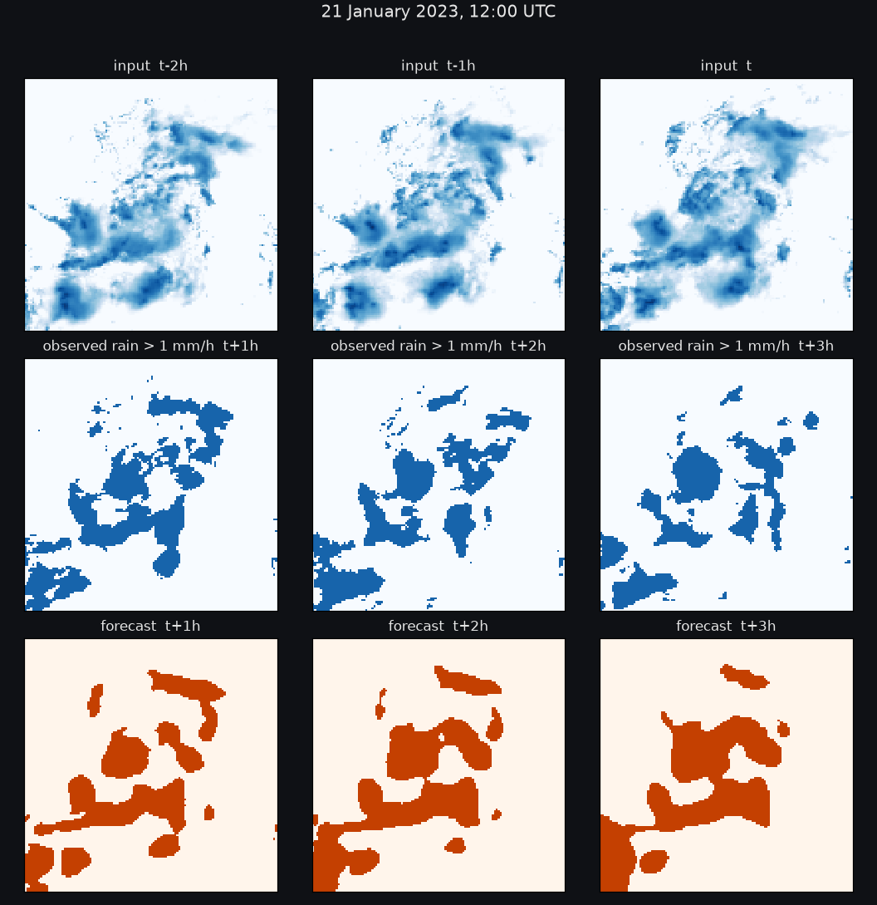

<div align="center">

# RAINCAST

**Rainfall nowcasting from satellite rain maps.**
Three hourly maps in, the next three hours out.

[](https://www.python.org/)
[](https://pytorch.org/)
[](https://github.com/qubvel/segmentation_models.pytorch)
[](LICENSE)
[](#results)



</div>

## What it does

Given three consecutive hourly rain-rate maps over Madagascar (128 x 128 pixels, t-2h, t-1h, t), RAINCAST
forecasts where it will rain at t+1h, t+2h and t+3h. The forecast is scored with the Fractions Skill Score
(FSS) at 1 mm/h over 3 x 3 pixel neighbourhoods, a metric from operational weather verification that rewards
getting the rain *roughly* in the right place rather than pixel by pixel.

The system is an ensemble of 58 U-Net++ networks trained from random weights on the training seasons alone, a
calibration step, and a decoder that turns probabilities into the rain mask with the highest expected FSS.
No pretrained weights, no external data, no information shared between samples: each forecast reads one
sample's three maps and its timestamp.

## Highlights

- **Metric-driven design.** The network predicts, per lead time, the probability that a pixel exceeds 1 mm/h.
  The loss is binary cross-entropy plus a *soft FSS* term (the metric itself, on probabilities) and a soft CSI
  term. The decoder maximises the expected FSS of the mask, which lets it place partial masks where the
  rain is uncertain instead of applying a hard threshold.
- **Honest validation.** One full rainy season (December 2022 to March 2023, 2,887 hours) is held out.
  Consecutive samples overlap in time, so a random split would leak; every threshold, calibration table and
  decoder setting is tuned on that season only.
- **Twins for the test period.** Each validation network has a full-data twin (same settings, seed + 100,
  trained on every season). The twins forecast the test period; the validation networks fit the decoder.
- **Small details that matter.** The input is enlarged 3x before the encoder so deep layers keep spatial
  detail; climatology channels tell the network how often each pixel rains at that hour, counted out of fold;
  the probabilities of the last six epochs of each run are averaged.
- **Reproducible from one file.** `final/submission.json` lists every member, its weight and the fitted
  decoder; `runs/` holds the exact command of every training session; seeds are fixed.

## How it works

```
 3 rain maps ─┐
 hour, season ├─▶ U-Net++ (ResNet-34, random init, 3x upscaled) ─▶ p(rain > 1 mm/h) per lead
 climatology ─┘                     x 58 members, weighted blend
                                              │
                        isotonic calibration (per lead, held-out season)
                                              │
                  expected-FSS decoder: argmax over masks of  Σ M·q − μ Σ box(M)²
                                              │
                                      rain mask at +1h, +2h, +3h
```

1. **One network** (`src/train_unet.py`): U-Net++ decoder, ResNet-34 encoder from random weights, inputs
   `log1p(rain)/2` plus coordinate, hour and season channels; AdamW with a one-cycle schedule, batch 16,
   14 epochs, dropout 0.2, random translations, mixed precision.
2. **The blend** (`src/blend.py`): a weighted mean of the members' probability maps, weights 1 to 3 by family.
3. **Calibration and decoding** (`src/fss_decode.py`): an isotonic fit per lead time maps the blend to observed
   rain frequencies; with calibrated probabilities p and q = box(box(p)), the expected FSS of a mask M is a
   ratio whose numerator is linear in M, maximised by iterated conditional modes.
4. **The forecast** (`src/twins.py`, `src/make_submission.py`): the twins' test probabilities, blended with the
   same weights and decoded with the fitted calibration and μ.

`docs/APPROACH.md` explains why each piece is there and what was tried and rejected.

## Results

Held-out season, pooled FSS over 2,887 hours:

| Forecast | FSS |
| --- | ---: |
| Persistence (copy the map at t) | 0.604 |
| Best single network, thresholds per lead time | 0.715 |
| 58-member blend, thresholds per lead time | 0.719 |
| **58-member blend, calibrated and decoded** | **0.770** |

On the 200-sample test period the final forecast scores **0.7838** (public subset of the
[Kaggle hackathon](https://www.kaggle.com/competitions/hackathon-IndabaX-MDG-2026) this work was built for,
second place at the deadline). Nothing beyond the three input maps and the timestamp is used: `docs/RULES.md`
goes through the competition's rules one by one and documents the software and the AI assistance used.

## Repository layout

| Path | Content |
| --- | --- |
| `src/train_unet.py` | Training, validation, per-epoch probabilities and test inference of one network. |
| `src/fss.py` | The metric (pooled over samples, and per sample). |
| `src/blend.py` | Weighted blend of validation probabilities, thresholds, calibration and decoder fit. |
| `src/fss_decode.py` | Isotonic calibration and the expected-FSS decoder. |
| `src/twins.py` | Pairs each validation member with its full-data twin's test probabilities. |
| `src/make_submission.py` | Blends test probabilities, decodes them and writes the forecast file. |
| `src/fetch_runs.py` | Compacts a training session's output: best last-k blend of each run, mean test probabilities. |
| `src/advect.py`, `src/context_calib.py`, `src/eval_decode.py`, `src/lastk_testprob.py` | Optical-flow baseline, neighbourhood-aware calibration, decoder check, epoch averaging (not in the final forecast). |
| `tools/build_kernel_queue.py` | Turns a run list into one script that trains the runs side by side on GPUs or TPU chips. |
| `tools/build_cloud_job.py` | Runs such a queue on a cloud GPU sandbox, results uploaded to a private Kaggle dataset. |
| `tools/build_review_kernel.py` | Builds the reproduction notebook and the datasets it reads. |
| `tools/plot_forecast.py` | Draws a validation case (the figure above). |
| `runs/` | The run list of every training session, with the reason for each group of runs. |
| `final/members.md`, `final/submission.json` | The 58 members: settings, sessions, scores, weights, decoder. |
| `docs/APPROACH.md`, `docs/RULES.md` | Design rationale; rules, software and attribution. |

## Quick start

```bash
uv venv -p 3.12 .venv && source .venv/bin/activate
uv pip install -r requirements.txt
kaggle competitions download -c hackathon-IndabaX-MDG-2026 -f train.npz -p data
kaggle competitions download -c hackathon-IndabaX-MDG-2026 -f test.npz -p data
```

Train one network and score it on the held-out season (about 40 minutes on a modern GPU):

```bash
cd src
python train_unet.py --data ../data --out ../outputs/demo --threads 4 --save_each --keep_epochs 6 \
  --lr 1e-3 --aug 2 --dropout 0.2 --bs 16 --upscale 3 --amp 1 --eval_bs 32 \
  --arch UnetPlusPlus --encoder resnet34 --epochs 14 --clim 1 --clim_oof 1 --csi_w 1.0 --seed 1685
```

## Reproducing the final forecast

1. **Train the members and their twins.** Each session is a run list in `runs/` (the sessions of the final
   members are named in `final/members.md`; twins are the `--full` lines with seed + 100). A list becomes one
   script that trains its runs side by side within a time budget:

   ```bash
   python tools/build_kernel_queue.py indabax-cloud-set9 runs/cloud-scratch-set9.txt 10.25 --gpu --runs-per-gpu 2
   ```

   On Kaggle: `kaggle kernels push -p kernel/indabax-cloud-set9 -t 43200`, then
   `python src/fetch_runs.py cocofioren/indabax-cloud-set9 outputs/cloud-set9` once the session ends.
   On a cloud sandbox: `python tools/build_cloud_job.py indabax-cloud-set9 indabax-cloud-set9-results`
   publishes the job to a private Kaggle dataset; the notebook it writes runs the job and uploads the
   compacted results.

2. **Blend and fit the decoder** on the held-out season:

   ```bash
   cd src
   M=$(python -c "import json; c = json.load(open('../final/submission.json')); print(' '.join('../' + m for m in c['members']))")
   W=$(python -c "import json; print(','.join(map(str, json.load(open('../final/submission.json'))['weights'])))")
   python blend.py --data ../data --out ../outputs/final.json --decode 1 --mu 0.425,0.375,0.35 --weights $W $M
   ```

3. **Decode the twins' test probabilities** and write the forecast file:

   ```bash
   python make_submission.py ../outputs/submission.csv ../outputs/final.json $(python twins.py $M)
   ```

Seeds are fixed; GPU kernels and mixed precision keep the runs reproducible to a few 1e-4 of FSS. A Kaggle
notebook built by `tools/build_review_kernel.py` performs steps 2 and 3 from the saved probability maps and
checks the result against the submitted file.

## References

- Roberts, N. M., and Lean, H. W. (2008). Scale-selective verification of rainfall accumulations from
  high-resolution forecasts of convective events. *Monthly Weather Review*, 136(1), 78-97.
- Amell, A., Hee, L., Pfreundschuh, S., and Eriksson, P. (2025). Probabilistic near-real-time retrievals of
  Rain over Africa using deep learning. *Journal of Geophysical Research: Atmospheres*, 130, e2025JD044595.
- Zhou, Z., et al. (2018). UNet++: A nested U-Net architecture for medical image segmentation. *DLMIA 2018*.
- Iakubovskii, P. (2019). Segmentation Models Pytorch. https://github.com/qubvel/segmentation_models.pytorch

## License

MIT. The rain maps belong to their original sources (Rain over Africa) and are not part of this repository.
